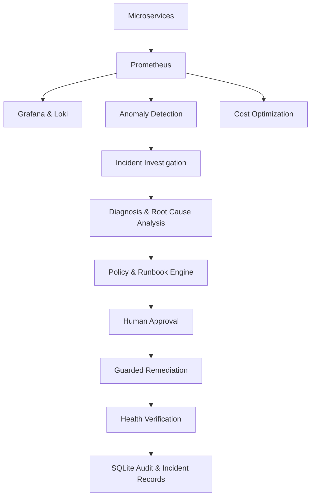

# Kybernaut
### Agentic AIOps for Infrastructure Reliability & Cost Optimization

Kybernaut is an Agentic AIOps platform that monitors application infrastructure, detects anomalies, investigates incidents, identifies possible root causes, and recommends controlled remediation with human approval. It also provides infrastructure reliability insights and cost optimization recommendations.

## Project Demo

[](https://youtu.be/DR0Syoa2c1w)

[Watch the Full Demo](https://youtu.be/DR0Syoa2c1w)

## Architecture



## Key Features

- **Infrastructure Monitoring:** Prometheus-based monitoring and Grafana dashboards.
- **Anomaly Detection:** Direction-aware Median/MAD detection and Isolation Forest.
- **Agentic Investigation:** LangGraph-based incident diagnosis and root-cause analysis.
- **Controlled Remediation:** Runbook-driven actions with policy enforcement and human approval.
- **Observability:** Centralized metrics and logs using Prometheus, Grafana, and Loki.
- **Cost Optimization:** Resource utilization analysis, right-sizing recommendations, and potential savings estimates.
- **Security & Auditing:** JWT authentication, permission controls, approval workflows, and persistent audit records.

## Technology Stack

| Category | Technologies |
|---|---|
| Backend | Python, FastAPI, Uvicorn |
| Frontend | React, TypeScript, Vite |
| AI & Agents | LangGraph, LangChain, Groq |
| Machine Learning | NumPy, Scikit-learn |
| Monitoring | Prometheus, Grafana |
| Logging | Loki, Grafana Alloy, Promtail |
| Infrastructure | Docker, Docker Compose, Kubernetes |
| Database | SQLite, PostgreSQL |
| Security | PyJWT, Argon2 |
| Testing & CI | Pytest, Vitest, GitHub Actions |

## Anomaly Detection Evaluation

Synthetic evaluation of the direction-aware anomaly detector:

| Metric | Result |
|---|---:|
| Services | 4 |
| F1 Score | 71.43% |
| Precision | 90.91% |
| Recall | 58.82% |
| False Positive Rate | 3.70% |

*Results are based on synthetic or assumed labels, not independently verified production data.*

## Local Demo

Clone the repository:

```bash
git clone https://github.com/Janviswa/kybernaut.git
cd kybernaut
```

Install dependencies:

```bash
python3 -m venv .venv
.venv/bin/python -m pip install -r requirements.txt
```

Run the local incident demo:

```bash
.venv/bin/python -m scripts.demo_incident
```

Run tests:

```bash
.venv/bin/python -m pytest -q
```

## Author

**Janani V. (Janviswa)**

- GitHub: [@Janviswa](https://github.com/Janviswa)
- Portfolio: [jananiv.in](https://jananiv.in)
