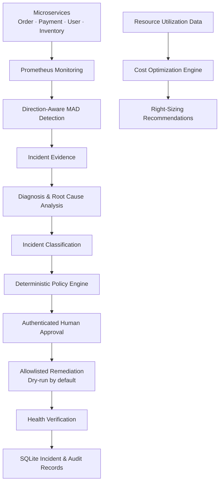

 <h1 align="center">Kybernaut</h1>

<p align="center">
  <strong>Agentic AIOps for Infrastructure Reliability & Cost Optimization</strong>
</p>

<p align="center">
  An infrastructure operations platform that detects anomalies, investigates incidents, recommends recovery actions, and supports human-approved remediation with auditability.
</p>

<p align="center">
  <a href="https://youtu.be/DR0Syoa2c1w">
    
  </a>
</p>

<p align="center">
  <a href="https://youtu.be/DR0Syoa2c1w">Watch Project Demo</a> ·
  <a href="https://github.com/Janviswa/kybernaut">GitHub Repository</a>
</p>

---

## Overview

Kybernaut brings monitoring, machine-learning-based anomaly detection, incident investigation, controlled remediation, and cost optimization into one workflow.

It combines deterministic policy enforcement with agent-assisted investigation to help operators make informed infrastructure decisions while keeping sensitive actions behind authorization and approval controls.

## Architecture



## Core Capabilities

| Module | Technical implementation |
|---|---|
| Monitoring | Prometheus metrics collection |
| Anomaly Detection | Direction-aware Median Absolute Deviation (MAD), Isolation Forest |
| Incident Investigation | LangGraph workflow and LangChain integrations |
| Diagnosis | Service evidence and runbook-based investigation |
| Decision Engine | Deterministic classification and policy rules |
| Remediation | Allowlisted actions, approval checks, cooldowns and retry limits |
| Verification | Service health checks and post-action status |
| Audit | Persistent SQLite incident, approval and audit records |
| Cost Optimization | CPU/memory utilization analysis and right-sizing recommendations |

## Technical Stack

| Category | Technologies |
|---|---|
| Backend | Python, FastAPI, Pydantic, Uvicorn |
| Frontend | React, TypeScript, Vite, Recharts |
| AI & Agent Workflows | LangGraph, LangChain, Groq (optional) |
| Machine Learning | NumPy, Scikit-learn |
| Monitoring | Prometheus, Grafana |
| Logging | Loki, Grafana Alloy |
| Containers | Docker, Docker Compose |
| Orchestration Lab | Kubernetes, kind |
| Databases | SQLite, PostgreSQL |
| Authentication | JWT, Argon2 |
| Testing | Pytest, HTTPX, Vitest |
| CI | GitHub Actions |

## Monitored Services

Kybernaut monitors four containerized services:

- **Order Service** — Port `8001`
- **Payment Service** — Port `8002`
- **User Service** — Port `8003`
- **Inventory Service** — Port `8004`

Prometheus collects service metrics, while Grafana provides visibility into infrastructure and application performance.

## Anomaly Detection & Evaluation

The anomaly detection module uses a direction-aware MAD policy to identify unusual changes in resource metrics. Isolation Forest is also implemented as a separate anomaly detector.

**Synthetic benchmark results**

| Metric | Result |
|---|---:|
| Precision | 90.91% |
| Recall | 58.82% |
| F1-score | 71.43% |
| False-positive rate | 3.70% |

These results are from a synthetic, point-level benchmark with assumed labels. They are not production monitoring accuracy or incident-level performance.

## Incident Response & Safety

Kybernaut uses a controlled incident-response workflow:

1. Detect anomalies and collect incident evidence.
2. Investigate the incident and identify relevant runbooks.
3. Classify the incident and evaluate deterministic policies.
4. Require an authenticated operator approval.
5. Validate fresh evidence and remediation prerequisites.
6. Execute only an allowlisted action.
7. Record execution and verification status in the audit trail.

**Safety controls**

- JWT-based operator authentication and permissions.
- Requester/approver separation where applicable.
- Persisted approval and idempotency controls.
- Fresh policy and evidence validation.
- Service and action allowlisting.
- Cooldown and retry limits.
- Dry-run execution by default.
- Persistent audit records.

## Cost Optimization

The cost optimizer analyzes CPU and memory utilization to identify potential right-sizing opportunities and capacity pressure.

It produces resource recommendations and estimated potential savings using an example pricing catalog. Recommendations are advisory; no infrastructure changes or realized savings are claimed by the report.

## Local Demo

Run the simulated end-to-end workflow locally:

```bash
python3 -m venv .venv
.venv/bin/python -m pip install -r requirements.txt
.venv/bin/python -m scripts.demo_incident
```

The demo exercises the active anomaly policy, authenticated response route, deterministic policy checks, distinct-operator approval, dry-run execution, SQLite audit persistence, and cost-optimizer calculation.

**Demo scope:** Telemetry, diagnosis, Kubernetes/OOM evidence, approval operators, and cost inputs are synthetic or mocked. The demo does not connect to Prometheus or Kubernetes, invoke an external RCA provider, execute a live remediation, or verify workload recovery.

For the full setup, benchmark commands, API documentation, and test instructions, see the repository documentation.

---

<p align="center">
  Built by <strong>Janani V</strong>
</p>

<p align="center">
  <a href="https://github.com/Janviswa">GitHub</a> ·
  <a href="https://jananiv.in">Portfolio</a>
</p>
